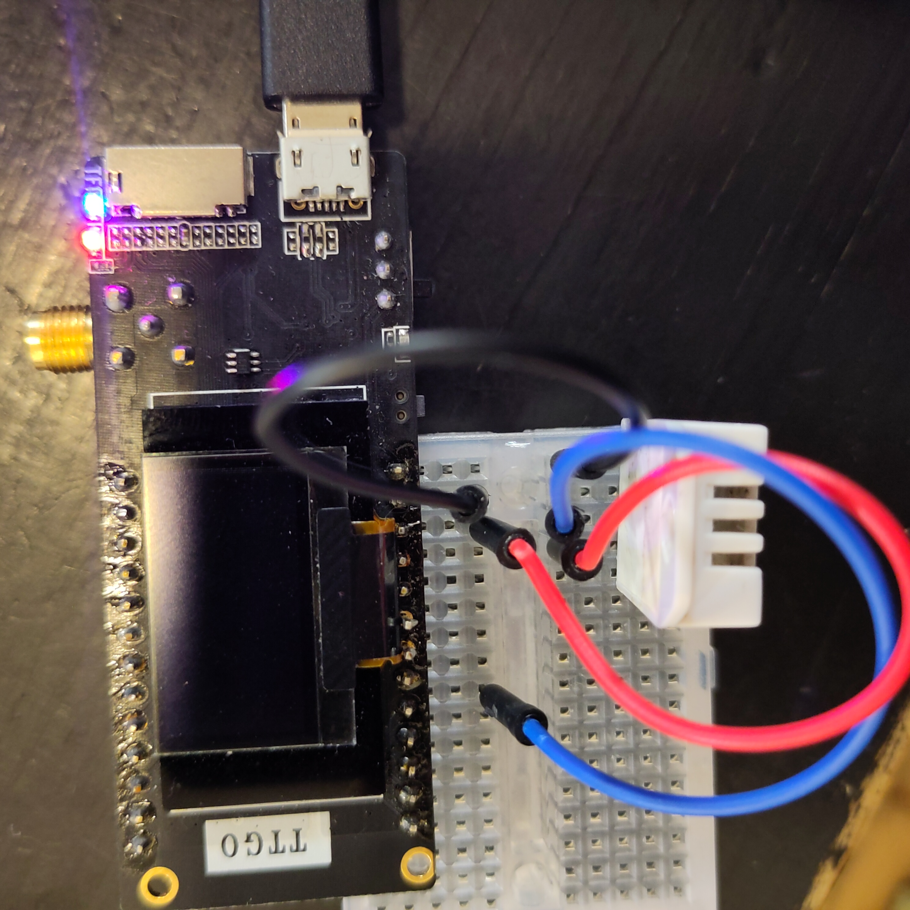

Below is the step-by-step description how to make your own weatherstation and publish the results to the public website https://wow.meteo.be.

**1. Gather the hardware parts**

I've used an ESP32 processor with built in Wifi and an OLED screen: _ESP32 TTGO LoRa32 (LilyGO T3-v1.6)._ The screen is needed to check the status and connect to wifi.
It is probably also possible to do the same with an Arduino, but I haven't tried it.
You'll also need a temperature sensor, I tried both a DHT22 and a DS18B20. The latter comes in a waterproof cable that makes it easier to put the sensor outside while keeping your weather station in a dry place. The code works for both sensors.

**2. Assemble the hardware into a weather station**
Connect the ESP to a breadboard. A small size will do since you only need 3 connections.

DHT22 - I'm using the version with 4 pins. They should be connected as follows:
- pin 1 (left): VCC which is 3.3V on the ESP
- pin 2 DATA: connect to ESP pin 23
- pin 3: not used
- pin 4 (right); GND connect to GND
It is advised to add a 4k7 resistor between VCC and DATA, but it will probably also work without.

  
  *Connect DHT22 sensor to ESP32.*

DS18B20 - my version has 3 wires: red - white - yellow
- red    :  connect to VCC
- white  :  connect to pin 23
- yellow :  connect to GND
With this sensor you need to add the 4k7 resistor between VCC (red) and DATA (yellow).

**3. Add the code**
Connect the ESP to your computer using a USB data cable (a power cable is not sufficient).

Open Arduino IDE and open the .ino file in this repository.

Install the necessary libraries:
- WiFiManager	              by tzapu
- DHT sensor library	      by Adafruit
- Adafruit Unified Sensor   by Adafruit
- Adafruit GFX Library	    by Adafruit
- Adafruit SSD1306	        by Adafruit
- OneWire	                  by Paul Stoffregen
- DallasTemperature	        by Miles Burton
During installation of these libraries, make sure to install all dependencies ("Install all").

Install the ESP32 board via Tools -> Boards -> Borads Manager and look for esp32 by Espressif Systems. You can use the ESP32 Dev Module.

**4. Register on the WOW website**
Every weather station needs to be registered on the WOW site. You can find the explanation on https://wow.meteo.be/en/join/

Make an account, log in and register a site. Important elements to enter are 
- longitude and latitude coordinates of the position of the weather station (so everyone can see it on the map)
- name (give a descriptive name)
- choose an authentication key (keep it to yourself it is private, everyone with this key can publish to this weather station) 

Make sure to copy following data elements somewhere (for example in notepad)
- authKey, this is the authentication key you chose
- siteID, this is the long ID that is visible as the first element in the WOW dashboard

**5. Fill in the credentials**
Now go back to you Arduino IDE and fill in the missing credentials
- line 18  authKey (the authentication key you chose)
- line 21  name (a name you can give to the ESP board, it will be shown on the OLED but not on WOW. Keep is short < 5 characters)
- line 22  siteID (the long ID you copied from the WOW dashboard)

Compile, upload and test.

**6. Test**
a. Connect ESP to wifi
- Connect the ESP weather station to an USB power source (computer of via USB power).
- He will first check if he can connect to wifi. If not, he will set up a local wifi network called WOW-weatherstation.
- Use your phone or laptop and connect to the wifi network with SSID WOW-weatherstation. This connects you temporarily to the ESP, but you will not have internet at this time.
- Go to the address shown on the OLED screen, usually this is 192.168.4.1. You will now see the menu created by the ESP.
- Select the first option, choose the wifi network SSID and fill in the password. The ESP will remember the password, but it will not be shared to the WOW site.

b. Try out if it works
- The weather station will be in deep sleep most of the time to save energy. During that time it doesn't do anythings and the OLED is black. Only some of the leds on the board will be lit.
- Every 5 minutes the weather station will wake up, connect to wifi, measure the temperature, show it on the OLED and send it to the WOW website.
- Go to the WOW site (https://wow.meteo.be/en/), navigate to the position of your weather station and check the results. They will be updated every 5 minutes.
